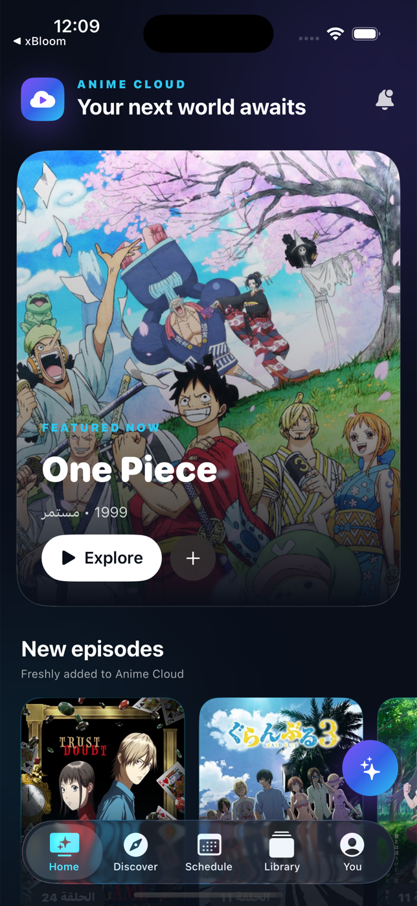
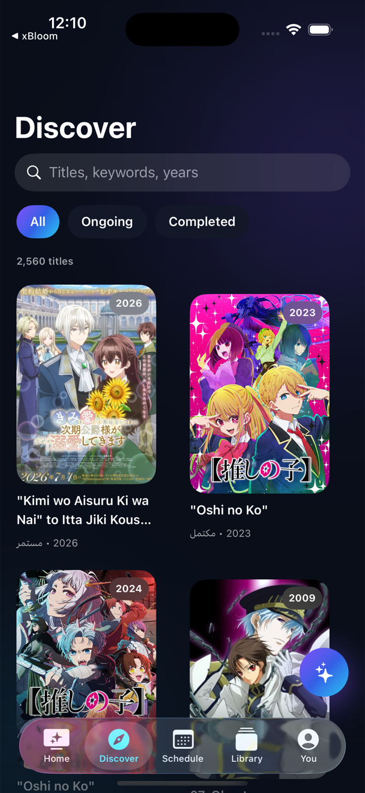
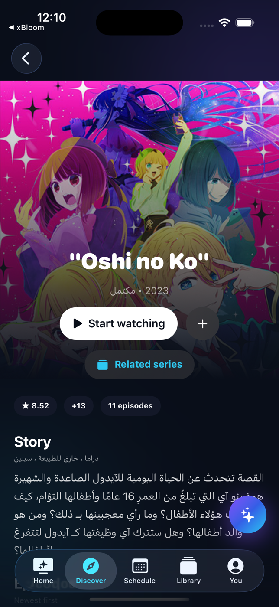
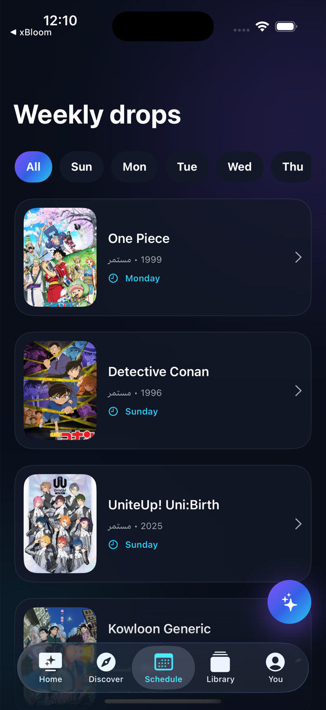

# AnimeCloud

A native SwiftUI client for discovering, tracking, and watching anime from the Anime Cloud catalog on iPhone and iPad.

[](https://developer.apple.com/ios/)
[](https://www.swift.org/)
[](https://github.com/Lui35/AnimeCloud/actions/workflows/main-ci.yml)
[](https://github.com/Lui35/AnimeCloud/releases/latest)

## Screenshots

<p align="center">
  
  
  
  
</p>

## Highlights

- Live home, discovery, weekly schedule, title details, episodes, comments, and playback
- Shared player controls with fullscreen gestures, AirPlay, Picture in Picture in standard mode, and per-episode resume positions
- Optional real-time Anime4K Metal upscaling with all Fast and High Quality presets
- Favorites, Watched, Watch Later, Watching Now, watch history, and legacy-compatible cloud sync
- Episode-level watched state, automatic Up Next handling, replay, and all-caught-up states
- Related series navigation for sequels and prequels
- Optional AniList OAuth sync for library status and highest-watched-episode progress
- Gemini-assisted watch-order research with web sources and saved, on-device watch plans
- Arabic and English content support
- A native SwiftUI codebase using URLSession, AVKit, Metal, SQLite, and CommonCrypto

## Install from LiveContainer Sources

In **LiveContainer → Sources → +**, add:

```text
https://github.com/Lui35/AnimeCloud/releases/latest/download/source.json
```

Or open [Add AnimeCloud to LiveContainer](livecontainer://source?url=https%3A%2F%2Fgithub.com%2FLui35%2FAnimeCloud%2Freleases%2Flatest%2Fdownload%2Fsource.json) on your phone. Confirm the source, then choose Anime Cloud and tap **Install**. Refresh the source to see new published releases.

Each release generates its source metadata from the packaged IPA, including its exact version, build number, download size, and minimum iOS version. The source follows published releases; changes merged into `main` appear after a new release is published.

## Install the unsigned IPA

Each versioned [GitHub Release](https://github.com/Lui35/AnimeCloud/releases) includes:

- `AnimeCloud-vX.Y.Z-unsigned.ipa` — the installable application archive
- `AnimeCloud-vX.Y.Z-unsigned.ipa.sha256` — its SHA-256 checksum

Download the IPA from the latest release and import it into LiveContainer or another compatible sideloading tool. The IPA is intentionally unsigned: its `Payload/AnimeCloud.app` contains no embedded provisioning profile or stale signature, allowing the installation tool to sign it for the target device.

The checksum can be verified on macOS with:

```sh
shasum -a 256 -c AnimeCloud-vX.Y.Z-unsigned.ipa.sha256
```

> The IPA is not an App Store package and cannot be installed directly by tapping it. You are responsible for using an appropriate signing or container solution and complying with Apple’s and the content provider’s terms.

## Build from source

Requirements:

- Xcode 16 or newer
- iOS 17 or newer deployment target
- An Apple Development team when installing directly on a physical device

AnimeCloud vendors its Anime4K Metal package, so no package download is required. Xcode 26 separates the Metal compiler into a downloadable component; install it once if Xcode prompts, or run:

```sh
xcodebuild -downloadComponent MetalToolchain
```

Then:

1. Open `AnimeCloud.xcodeproj` in Xcode.
2. Select the **AnimeCloud** scheme and a compatible iPhone or iPad.
3. Choose your team under **Signing & Capabilities**.
4. Build and run.

No dependency fetch is required; the compatible Anime4K Metal source and notices are kept under `ThirdParty/`.

To produce the same unsigned device archive used by CI:

```sh
Scripts/build-unsigned-ipa.sh
```

The resulting file is written to `Build/Unsigned/AnimeCloud-unsigned.ipa`.

## Export downloaded episodes

Open **Downloads → Export all** to save every completed download, or open an anime and choose **Export all** for that series. An episode’s options menu also has **Export video**. Choose a destination in the Files picker.

Exports contain an **Anime Cloud** folder with one folder per anime and video filenames such as `Series - Episode 1.mp4`. Duplicate names receive a number instead of overwriting another episode. The exported copies remain available after removing downloads from the app, and can be opened from Files in compatible players such as VLC.

Streaming downloads are converted to MP4 when iOS supports it. If conversion fails, the export reports an error and keeps the original downloads intact. Only completed downloads are included; exports need additional free space for the copies.

## Anime4K playback

AnimeCloud can upscale video in real time with Anime4K shaders running on the device's Metal GPU. Open the sparkle menu in the top-right controls to choose **Off**, any **Fast** preset, or any **High Quality** preset. The available presets are A, B, C, A+A, B+B, and C+A in both quality tiers. Selecting **Off** plays the original video with the same controls.

The same menu is available before and during fullscreen playback, so the mode can be changed without leaving fullscreen. Swipe up on the video to enter fullscreen and swipe down in the center to exit. In landscape fullscreen, swipe vertically on the left for playback volume or on the right for brightness. Tap the video to show or hide the controls.

Use the gauge button in the top-left corner to run the device benchmark. It tests all 12 presets at the current display target, pauses playback during the test, and resumes it afterward. The result shows average and worst processing times, recommends the highest-quality preset that can sustain 30 fps with headroom, and provides a **Use Recommended** action.

Run the benchmark on the physical iPhone or iPad you intend to use. A simulator benchmark measures the Mac's GPU and is not representative of performance on the iOS device.

## Watch Plans and Gemini

Open an anime, choose **Related series → Watch order**, then select first-time viewing, story chronology, or main-story viewing. **You → Gemini watch planner** accepts your personal Gemini API key from [Google AI Studio](https://aistudio.google.com/apikey). The key stays in this device's Keychain; it is not included in the IPA or saved in preferences.

Research uses Gemini 3.8 Flash with Google Search and structured output. The request sends only the selected title and related title/year metadata. It does not send your account, library, or watched history to Gemini. Google API usage is charged to your own project and follows Google's data policies. Research requires an internet connection and a project with model and search access. Google Search grounding for Gemini 3.8 Flash is not included in the free tier; a free API key alone does not enable the planner's web research. Check the project's active limits in Google AI Studio. Quotas are project-wide, so another app or key in the same project can consume them.

The app displays the original guide, source citations, and Google's search suggestions. It rejects incomplete or unsourced responses rather than substituting a made-up order. Sources do not guarantee correctness: review the guide, uncertainty, and catalog matches before saving a personal plan. The app does not bulk-generate, share, or automatically cache researched guides.

**Plans** holds the guides you explicitly save, along with local completion choices. Uniquely matched titles can be opened or played; missing or ambiguous matches stay visible and block automatic continuation until you match or explicitly complete them. Optional parts can be included, and watched library titles automatically count as complete unless you choose to rewatch them. Saved progress works offline; new research requires Gemini. **Home** shows the next part of your active plan, and the weekly schedule is available from the calendar button in **Discover**.

## AniList integration

1. Create an AniList API client with `animecloud://anilist-auth` as its redirect URL.
2. In AnimeCloud, open **You → AniList sync**, enter the numeric client ID, and authorize.
3. The first connection downloads existing AniList state before any upload. Later local changes synchronize after another download-first merge.

AniList exposes aggregate episode progress, so AnimeCloud sends the highest watched episode while retaining the detailed watched-episode set locally. Favorites remain local. Exact title/year matches are linked automatically; ambiguous matches are skipped. OAuth access tokens are stored in the iOS Keychain.

## Data safety

Cloud synchronization is download-first. The first login for an account is restore-only, preventing an empty local library from replacing an existing cloud backup. Later changes are debounced and merged automatically, including explicit removal tombstones for library and watched-episode state.

## Continuous integration and releases

The `main` branch is protected. Pull requests targeting `main` and pushes to `main` run **Main CI / Build and test**, which builds the app and runs its unit tests on an available iPhone simulator.

Pushing a semantic version tag such as `v1.0.0`, or manually running the release workflow with that tag, builds and validates the unsigned IPA. The workflow uploads the IPA and checksum to the GitHub Release and verifies both assets are present.

## Project structure

```text
AnimeCloud/
├── AI/               Gemini watch-order research
├── Components/       Shared SwiftUI components
├── Design/           Theme and visual system
├── Features/         Home, Discover, Schedule, Library, Profile, Details
├── Infrastructure/   Playback decryption and Anime4K rendering
├── Models/           Domain models
├── Networking/       Legacy API and AniList clients
└── Persistence/      Library and playback state
```

## Backend notice

AnimeCloud communicates with the original Anime Cloud servers through a legacy command-based API. Those endpoints are outside this repository’s control and may change or become unavailable without notice. Test account and write operations with non-critical data.
